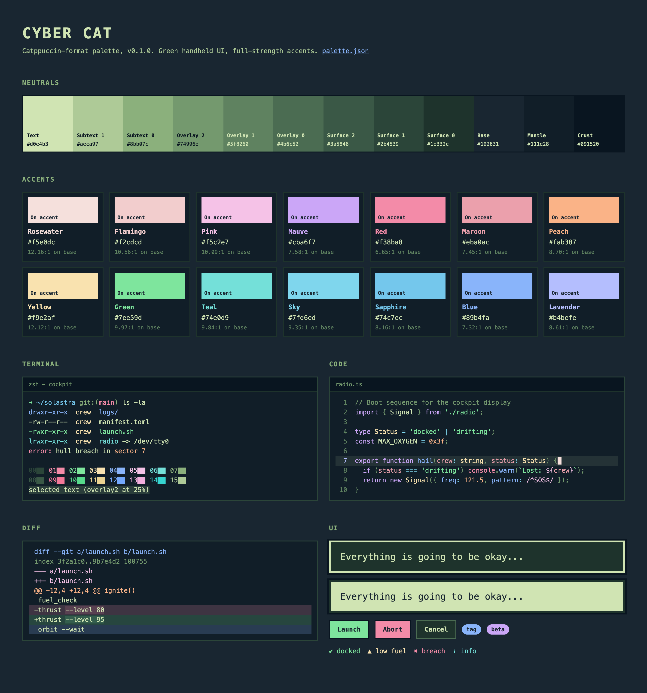

# Cyber Cat

* [style-guide](https://github.com/catppuccin/catppuccin/blob/main/docs/style-guide.md)
* [palette](https://github.com/catppuccin/palette)

A single dark flavor in the Catppuccin format. The 12 neutrals (crust to text) use the green handheld-screen colors below. The accents are Catppuccin Mocha values. Green, teal and sky are changed so that they stay different from the green UI text.



## Colors

<!-- swatches:start -->
| | Name | Hex | RGB |
|---|---|---|---|
|  | Rosewater | `#f5e0dc` | `245 224 220` |
|  | Flamingo | `#f2cdcd` | `242 205 205` |
|  | Pink | `#f5c2e7` | `245 194 231` |
|  | Mauve | `#cba6f7` | `203 166 247` |
|  | Red | `#f38ba8` | `243 139 168` |
|  | Maroon | `#eba0ac` | `235 160 172` |
|  | Peach | `#fab387` | `250 179 135` |
|  | Yellow | `#f9e2af` | `249 226 175` |
|  | Green | `#7ee59d` | `126 229 157` |
|  | Teal | `#74e0d9` | `116 224 217` |
|  | Sky | `#7fd6ed` | `127 214 237` |
|  | Sapphire | `#74c7ec` | `116 199 236` |
|  | Blue | `#89b4fa` | `137 180 250` |
|  | Lavender | `#b4befe` | `180 190 254` |
|  | Text | `#d0e4b3` | `208 228 179` |
|  | Subtext 1 | `#aeca97` | `174 202 151` |
|  | Subtext 0 | `#8bb07c` | `139 176 124` |
|  | Overlay 2 | `#74996e` | `116 153 110` |
|  | Overlay 1 | `#5f8260` | `95 130 96` |
|  | Overlay 0 | `#4b6c52` | `75 108 82` |
|  | Surface 2 | `#3a5846` | `58 88 70` |
|  | Surface 1 | `#2b4539` | `43 69 57` |
|  | Surface 0 | `#1e332c` | `30 51 44` |
|  | Base | `#192631` | `25 38 49` |
|  | Mantle | `#111e28` | `17 30 40` |
|  | Crust | `#091520` | `9 21 32` |
<!-- swatches:end -->

## Build

Requires Node 24. There are no dependencies.

```sh
npm test        # conversion, contrast and schema checks
npm run build   # writes dist/
```

| File | Contents |
|---|---|
| `dist/palette.json` | catppuccin/palette v1.8.0 schema, flavor key `cybercat` |
| `dist/cyber-cat.css` | `--ctp-<name>` (hex) and `--ctp-<name>-rgb` (`r g b`) on `:root` |
| `dist/_cyber-cat.scss` | `$<name>` variables and a `$colors` map |
| `dist/preview.html` | Swatches, terminal, code, diff and UI samples |

To change a color, edit `src/seeds.mjs`, then run `npm test` and `npm run build`.

## Seed colors


```json
{
  "colors": {
    "lightest_green": "#d0e4b3",
    "light_mid_green": "#8bb07c",
    "dark_mid_green": "#4b6c52",
    "darkest_green": "#1e332c",
    "outer_background": "#192631",
    "border_black": "#000000"
  }
}
```
